# Poncho Digital — API Backend (`TP_Lab_Backend_2026`)

---

## 11.1 Portada e Información Académica

- **Proyecto**: **Poncho Digital** (`TP_Lab_Backend_2026`) — Plataforma API REST para la gestión integral de artesanos, postulaciones, productos, stands y reportes de la **Fiesta Nacional e Internacional del Poncho**.
- **Asignatura**: Laboratorio de Desarrollo Backend (Trabajo Práctico Integrador — Entregas 1 a 8 + Rúbricas Nivel 1 y Nivel 2).
- **Carrera**: Tecnicatura Universitaria en Diseño de Software (TUDS).
- **Facultad y Universidad**: Facultad de Tecnología y Ciencias Aplicadas — **Universidad Nacional de Catamarca (UNCa)**.
- **Año Académico**: `2026`.
- **Integrantes del Equipo**:
  - **Leandro Lopez Rizo** — Matrícula Universitaria (MU): `331`
  - **Maximiliano Braga** — Matrícula Universitaria (MU): `328`

### Descripción Funcional del Sistema
**Poncho Digital** es el backend oficial para digitalizar el proceso de postulación, admisión, catálogo comercial y ubicación espacial de los artesanos en el Predio Ferial Catamarca durante la Fiesta Nacional e Internacional del Poncho:
1. **Visitantes públicos** pueden consultar el catálogo paginado de artesanos y productos, filtrar stands por pabellón/sector/estado, consultar coordenadas en formato JSON para mapas interactivos y registrar tendencias de búsqueda.
2. **Postulantes** pueden registrarse y enviar su solicitud de admisión en una transacción atómica (`PENDIENTE`).
3. **Administradores** evalúan las solicitudes (`APROBADA`, `RECHAZADA`, `MODIFICACION`). Al aprobar una postulación de forma transaccional, el sistema promueve automáticamente al usuario al rol **Artesano**. Además, los administradores gestionan stands, asignaciones, catálogos maestros, cuentas de usuario y reportes ejecutivos consolidados.
4. **Artesanos habilitados** administran exclusivamente su propio catálogo de productos (`POST`, `PUT`, `DELETE`, `GET /api/productos/mis-productos`) bajo reglas estrictas de propiedad de recursos.

---

## 11.2 Tecnologías y Versiones Utilizadas

| Tecnología | Versión | Propósito en el Proyecto |
| :--- | :--- | :--- |
| **Node.js** | `24.x LTS` | Entorno de ejecución JavaScript con módulos ES nativos (`"type": "module"`). |
| **Express** | `^5.2.1` | Framework HTTP para enrutamiento modular, cadena de middlewares y manejo centralizado de errores. |
| **PostgreSQL** | `15+ / 16+` | Motor de base de datos relacional para persistencia transaccional y pruebas aisladas (`*_test`). |
| **Prisma ORM** | `^6.19.3` | ORM tipado (`@prisma/client`), migraciones SQL versionadas, transacciones `$transaction` y agregaciones `_count`. |
| **Zod** | `^4.6.5` | Validación estricta de esquemas de entrada (`.strict()`) y conversión nativa a OpenAPI 3.0 con `z.toJSONSchema()`. |
| **JSON Web Tokens** | `^9.0.3` | Emisión y verificación de tokens `HS256` (`sub`, `jti`, `exp`) para autenticación stateless con soporte de revocación. |
| **bcrypt** | `^6.0.0` | Hashing criptográfico de contraseñas con factor de costo de `10` rondas de salting. |
| **swagger-autogen** | `^2.23.7` | Generación estática del contrato OpenAPI 3.0 (`swagger-output.json`) a partir del árbol de rutas de `src/app.js`. |
| **swagger-ui-express** | `^5.0.1` | Publicación local e interactiva de Swagger UI en `/docs` y `/api-docs` (con assets locales desde `swagger-ui-dist`). |
| **node:test** | Nativo (`Node 24`) | Ejecutor nativo de pruebas unitarias y de integración (`node:test` + `node:assert/strict`) sin dependencias externas. |

---

## 11.3 Arquitectura del Proyecto

El sistema implementa una **arquitectura en capas estricta** con separación de responsabilidades:

```text
TP_Lab_Backend_2026/
├── prisma/
│   ├── migrations/                  # Historial versionado de migraciones SQL de PostgreSQL
│   ├── schema.prisma                # Modelo relacional de datos e índices de optimización
│   └── seed.js                      # Seed idempotente parametrizado por variables de entorno (SEED_*)
├── src/
│   ├── config/
│   │   └── env.js                   # Validación fail-fast de variables críticas (JWT_SECRET, DATABASE_URL)
│   ├── controllers/                 # Controladores HTTP + anotaciones OpenAPI (#swagger.*)
│   ├── docs/
│   │   └── swagger.json             # Copia sincronizada del contrato OpenAPI 3.0
│   ├── documentacion/
│   │   └── esquemas.js              # Esquemas reutilizables OpenAPI 3.0 (z.toJSONSchema + respuestas)
│   ├── dtos/                        # Objetos de transferencia de datos (omisión de passwordHash y PII privado)
│   ├── middlewares/                 # autenticar, contextoUsuario, autorizarRoles, validarSchema, errorHandler
│   ├── routes/                      # Definición modular de endpoints Express 5
│   ├── schemas/                     # Validadores Zod de entrada con .strict()
│   ├── services/                    # Lógica de negocio, transacciones Prisma e invalidación de caché
│   ├── utils/
│   │   └── cache.js                 # Caché en memoria con TTL e invalidación selectiva por prefijo
│   ├── app.js                       # Configuración de Express exportable (sin app.listen para tests)
│   ├── index.js                     # Punto de entrada del servidor HTTP y tareas periódicas fuera de test
│   └── prisma.js                    # Instancia singleton de PrismaClient
├── tests/
│   ├── testHelper.js                # Aserciones de entorno *_test, servidor efímero y limpieza por FK
│   ├── 00_esquemas_unitarios.test.js
│   ├── 01_auth_seguridad.test.js
│   ├── 02_productos_propiedad.test.js
│   ├── 03_postulaciones.test.js
│   ├── 04_cuentas_admin.test.js
│   ├── 05_stands_filtros_ubicacion.test.js
│   └── 06_reportes_tendencias_prisma.test.js
├── .env.example                     # Plantilla segura de variables de entorno con placeholders
├── generar-docs.js                  # Script generador del contrato OpenAPI 3.0 (swagger-output.json)
├── package.json                     # Scripts npm y dependencias
├── poncho_digital_postman_collection.json # Colección Postman alineada con todos los módulos
└── swagger-output.json              # Contrato OpenAPI 3.0 generado
```

### Flujo Completo de una Petición HTTP

```mermaid
flowchart LR
    A["Cliente HTTP / Swagger / Postman"] --> B["Router (src/routes/*.routes.js)"]
    B --> C["Middleware autenticar (JWT HS256 + TokenRevocado)"]
    C --> D["Middleware contextoUsuario (Verifica usuario activo y rol en BD)"]
    D --> E["Middleware autorizarRoles (RBAC)"]
    E --> F["Middleware validarSchema (Zod .strict() + DTO)"]
    F --> G["Controlador (src/controllers/*.controller.js)"]
    G --> H["Servicio (src/services/*.service.js + Cache Invalidation)"]
    H --> I["Prisma ORM (PostgreSQL)"]
```


---

## 11.4 Configuración de Variables de Entorno

1. Copiar el archivo `.env.example` hacia `.env` para el entorno de desarrollo:
   ```bash
   cp .env.example .env
   ```
2. Crear el archivo `.env.test` en la raíz del proyecto para la ejecución de pruebas automatizadas sobre una base de datos aislada terminada en `_test`.

### Detalle de Variables de Entorno

| Variable | Obligatoria | Descripción | Ejemplo / Placeholder |
| :--- | :---: | :--- | :--- |
| `DATABASE_URL` | Sí | Cadena de conexión a PostgreSQL (`poncho_digital` en `.env`; `poncho_digital_test` en `.env.test`). | `postgresql://<USUARIO>:<PASSWORD>@localhost:5432/poncho_digital?schema=public` |
| `JWT_SECRET` | Sí | Clave secreta para firmar y verificar tokens JWT `HS256`. Si falta, el servidor aborta el inicio (`exit(1)`). | `<GENERAR_SECRETO_JWT_SEGURO_MIN_32_CARACTERES>` |
| `PORT` | No | Puerto HTTP del servidor (por defecto `3000` en desarrollo). | `3000` |
| `NODE_ENV` | Sí | Entorno de ejecución (`development`, `production` o `test`). | `development` |
| `SEED_ADMIN_EMAIL` | Sí (para seed) | Email de la cuenta inicial con rol `Administrador` creada por `npm run seed`. | `admin@ponchodigital.gob.ar` |
| `SEED_ADMIN_PASSWORD` | Sí (para seed) | Contraseña en texto plano (mínimo 6 caracteres) que `prisma/seed.js` hashea con `bcrypt` para el Administrador. | `<DEFINIR_PASSWORD_ADMIN_DESARROLLO>` |
| `SEED_ARTESANO_EMAIL` | Sí (para seed) | Email de la cuenta inicial con rol `Artesano` creada por `npm run seed`. | `artesano@ponchodigital.com` |
| `SEED_ARTESANO_PASSWORD` | Sí (para seed) | Contraseña en texto plano (mínimo 6 caracteres) que `prisma/seed.js` hashea con `bcrypt` para el Artesano. | `<DEFINIR_PASSWORD_ARTESANO_DESARROLLO>` |

> [!CAUTION]
> **Advertencia de Seguridad**: Nunca subas los archivos `.env` ni `.env.test` al repositorio Git. Ambos archivos están excluidos en `.gitignore` y las credenciales iniciales nunca están hardcodeadas en el código fuente.

---

## 11.5 Instalación, Prisma, Migraciones y Seed

```bash
# 1. Instalar dependencias
npm install

# 2. Generar el cliente de Prisma
npx prisma generate
```

### Aplicar Migraciones en una Base de Datos Limpia (Desarrollo y Testing)
```bash
# Aplicar todas las migraciones históricas en la base configurada en .env
npx prisma migrate deploy

# Aplicar las migraciones en la base aislada de pruebas (poncho_digital_test)
node --env-file=.env.test ./node_modules/prisma/build/index.js migrate deploy
```

### Resolución de Estado en Bases Locales Preexistentes
Si tenés una base de datos local creada antes de la separación de la migración intermedia `20261015000553_agregar_tokens_revocados` (donde la tabla `TokenRevocado` ya existe porque fue creada previamente por `20261015004809_add_nombre_usuario_and_token_revocado`), marcá dicha migración como aplicada **sin borrar datos**:
```bash
npx prisma migrate resolve --applied 20261015000553_agregar_tokens_revocados
npx prisma migrate deploy
```

### Ejecución del Seed Inicial Idempotente
```bash
npm run seed
```
**¿Qué datos crea `prisma/seed.js`?**
- **3 Roles base**: `Postulante`, `Administrador` y `Artesano`.
- **Catálogos maestros**: Localidades (`San Fernando del Valle de Catamarca`, `Belén`, `Santa María`), Rubros (`Textil`, `Cerámica`, `Cestería y Fibra Vegetal`), Categorías (`Ponchos y Mantas`, `Alfarería Tradicional`), Pabellones (`Pabellón Peregrina Zárate`, `Pabellón Bicentenario`) y Zonas (`Sector Telares Norte`, `Sector Alfarería Sur`).
- **Stands geolocalizados**: `A-101` y `A-102` con coordenadas JSON (`x`, `y`, `latitud`, `longitud`).
- **Usuarios iniciales**:
  - Cuenta **Administrador** (`SEED_ADMIN_EMAIL` / `SEED_ADMIN_PASSWORD`).
  - Cuenta **Artesano** (`SEED_ARTESANO_EMAIL` / `SEED_ARTESANO_PASSWORD`) con perfil de artesano, solicitud `APROBADA`, stand `A-101` asignado (`OCUPADO`) y un producto inicial (`Poncho Catamarqueño de Vicuña`).
- **Idempotencia**: Puede ejecutarse múltiples veces sin duplicar registros ni sobrescribir las contraseñas existentes.

---

## 11.6 Ejecución del Servidor

```bash
# Iniciar en modo producción / estándar
npm start

# Iniciar en modo desarrollo con recarga automática (node --watch)
npm run dev
```

- **URL Base del Servidor**: `http://localhost:3000`
- **Verificación de estado**: `GET http://localhost:3000/` devuelve `{ "estado": "OK", "servicio": "Poncho Digital API - Backend 2026" }`.

---

## 11.7 Roles y Permisos del Sistema

| Rol | Permisos Permitidos | Restricciones y Códigos HTTP ante Acciones No Autorizadas |
| :--- | :--- | :--- |
| **Visitante (sin token)** | Consultar catálogo público (`GET /api/artesanos`, `GET /api/productos`, `GET /api/stands`, `GET /api/stands/ubicacion`), catálogos auxiliares (`GET`), tendencias (`GET /api/estadisticas/tendencias`), registrarse (`POST /api/auth/register`), postularse (`POST /api/postulacion`) e iniciar sesión (`POST /api/auth/login`). | - Sin cabecera `Authorization` en ruta protegida $\rightarrow$ **`401 Unauthorized`**.<br>- Cabecera `Authorization` mal formada (sin prefijo `Bearer <token>`) $\rightarrow$ **`400 Bad Request`**.<br>- Token JWT inválido, expirado o revocado $\rightarrow$ **`401 Unauthorized`**. |
| **Postulante** | Consultar su propio perfil autenticado (`GET /api/auth/me`) y cerrar sesión (`POST /api/auth/logout`). | - Intentar crear productos mientras su solicitud sigue `PENDIENTE`, `RECHAZADA` o en `MODIFICACION` $\rightarrow$ **`403 Forbidden`**.<br>- Intentar acceder a rutas de `Administrador` $\rightarrow$ **`403 Forbidden`**. |
| **Artesano** | Todo lo anterior + crear productos propios (`POST /api/productos`), listar sus propios productos (`GET /api/productos/mis-productos`), editar (`PUT /api/productos/:id`) y eliminar (`DELETE /api/productos/:id`) **únicamente sus propios productos**. | - Intentar enviar `artesanoId` o `id_artesano` en el body $\rightarrow$ **`400 Bad Request`** (rechazado por Zod `.strict()`).<br>- Intentar modificar o eliminar un producto que pertenece a otro artesano $\rightarrow$ **`404 Not Found`** (sin revelar existencia ni alterar el dueño en BD).<br>- Intentar ejecutar acciones administrativas $\rightarrow$ **`403 Forbidden`**. |
| **Administrador** | Control total de solicitudes (`GET /api/solicitudes`, `PUT /api/solicitudes/:id/resolver`), usuarios (`CRUD /api/usuarios`, `POST /api/usuarios/administradores`, `PATCH /api/usuarios/:id/estado`), stands (`POST`, `PUT`, `DELETE`, `PUT /api/stands/:id/asignar`), artesanos (`POST`, `PUT`, `DELETE`), catálogos auxiliares y reportes consolidados (`GET /api/reportes/*`). | - Intentar crear productos en `/api/productos` (exclusivo del rol `Artesano`) $\rightarrow$ **`403 Forbidden`**.<br>- Intentar desactivar o eliminar al **último administrador activo** del sistema $\rightarrow$ **`409 Conflict`**. |

---

## 11.8 Endpoints Principales por Módulo

### 1. Autenticación (`/api/auth`)
- `POST /api/auth/register` — Registro público de usuario con rol inicial `Postulante` (`201`).
- `POST /api/auth/login` — Inicio de sesión y emisión de token JWT `HS256` (`200` / `401`).
- `GET /api/auth/me` — Datos del perfil autenticado actual verificando cuenta activa (`200` / `401` / `403`).
- `POST /api/auth/logout` — Cierre de sesión y revocación inmediata del token por `jti` (`204`).

### 2. Postulaciones y Solicitudes (`/api/postulacion` y `/api/solicitudes`)
- `POST /api/postulacion` — Alta transaccional de usuario `Postulante`, perfil `Artesano` y solicitud en estado `PENDIENTE` (`201`).
- `GET /api/solicitudes` — Listado paginado de solicitudes con filtro por `?estado=` (Solo `Administrador`, `200`).
- `GET /api/solicitudes/:id` — Detalle de una solicitud sin exponer `passwordHash` (Solo `Administrador`, `200` / `404`).
- `PUT /api/solicitudes/:id/resolver` — Resolución atómica (`APROBADA`, `RECHAZADA`, `MODIFICACION`). Al aprobar, asigna el rol `Artesano` al usuario; si ya estaba resuelta devuelve `409` (Solo `Administrador`).
- `POST`, `PUT`, `DELETE /api/solicitudes` — Operaciones administrativas directas sobre solicitudes (Solo `Administrador`).

### 3. Usuarios y Cuentas Administrativas (`/api/usuarios`)
- `GET /api/usuarios` y `GET /api/usuarios/:id` — Listado paginado y detalle de cuentas sin `passwordHash` (Solo `Administrador`).
- `POST /api/usuarios` — Creación administrativa de usuario recibiendo `password` y hasheándolo en el servidor con `bcrypt` (Solo `Administrador`, `201`).
- `POST /api/usuarios/administradores` — Alta específica de cuenta con rol `Administrador` (Solo `Administrador`, `201`).
- `PATCH /api/usuarios/:id/estado` — Activar/desactivar cuenta (`{ "activo": true | false }`) protegiendo al último administrador activo (`200` / `409`).
- `PUT /api/usuarios/:id` y `DELETE /api/usuarios/:id` — Actualización y baja de usuarios protegiendo al último administrador activo (`200` / `204` / `409`).

### 4. Artesanos (`/api/artesanos`)
- `GET /api/artesanos` y `GET /api/artesanos/:id` — Catálogo público paginado y detalle de artesanos usando `artesanoPublicoDTO` (omite DNI, teléfono y dirección privada).
- `POST`, `PUT`, `DELETE /api/artesanos` — Gestión administrativa de perfiles de artesanos (Solo `Administrador`).

### 5. Productos (`/api/productos`)
- `GET /api/productos` y `GET /api/productos/:id` — Catálogo público paginado con filtros (`?nombre=`, `?categoria=`, `?rubro=`, `?precioMin=`, `?precioMax=`) y registro automático de tendencias de búsqueda.
- `GET /api/productos/mis-productos` — Listado de productos pertenecientes al artesano autenticado (Solo `Artesano`).
- `POST /api/productos` — Alta de producto asignando `id_artesano` desde el contexto JWT del artesano autenticado (Solo `Artesano`, `201`).
- `PUT /api/productos/:id` y `DELETE /api/productos/:id` — Edición y baja verificando propiedad del recurso; si pertenece a otro artesano devuelve `404 Not Found` (Solo `Artesano`).

### 6. Stands y Ubicaciones (`/api/stands`)
- `GET /api/stands` — Listado público paginado con filtros por `?pabellon=`, `?zona=`, `?sector=` y `?estado=DISPONIBLE|OCUPADO`.
- `GET /api/stands/ubicacion` y `GET /api/stands/:id/ubicacion` — Ubicación espacial de stands con pabellón, sector y coordenadas en JSON (`x`, `y`, `latitud`, `longitud`).
- `PUT /api/stands/:id/asignar` — Asignación o desasignación de un artesano a un stand actualizando automáticamente su estado a `OCUPADO` o `DISPONIBLE` (Solo `Administrador`).
- `POST`, `PUT`, `DELETE /api/stands` — ABM de stands (Solo `Administrador`).

### 7. Reportes Administrativos (`/api/reportes`)
- `GET /api/reportes` — Reporte ejecutivo consolidado (totales, artesanos por localidad, artesanos por rubro, ocupación de stands y productos por artesano) con caché en memoria (`X-Cache: HIT | MISS`).
- `GET /api/reportes/artesanos-por-localidad`, `/artesanos-por-rubro`, `/stands-ocupacion`, `/productos-por-artesano`, `/tendencias-busqueda` — Reportes específicos con soporte de caché (Solo `Administrador`).

### 8. Estadísticas y Catálogos Auxiliares
- `GET /api/estadisticas/tendencias` — Ranking público de términos más buscados por los visitantes en el catálogo.
- `/api/categorias`, `/api/localidades`, `/api/rubros`, `/api/pabellones`, `/api/zonas`, `/api/roles`, `/api/inscripciones` — Lectura pública (`GET`, excepto `/api/roles` e `/api/inscripciones` que requieren `Administrador`) y escritura protegida exclusivamente para `Administrador`.

---

## 11.9 Documentación Swagger / OpenAPI (Nivel 1)

El contrato OpenAPI 3.0 cumple íntegramente con la rúbrica de **Nivel 1**:
- Los esquemas de entrada se convierten dinámicamente desde los validadores Zod en `src/documentacion/esquemas.js` usando `z.toJSONSchema(schema, { target: "openapi-3.0", io: "input" })`.
- Todos los `$ref` apuntan a `#/components/schemas/...` y resuelven sin errores.
- Swagger UI sirve sus archivos estáticos (`swagger-ui.css`, `swagger-ui-bundle.js`, `swagger-ui-standalone-preset.js`) localmente desde `swagger-ui-dist`, funcionando **100% offline** sin depender de CDNs externos (`unpkg.com`).

### Comandos y Rutas de Documentación
```bash
# Regenerar swagger-output.json y src/docs/swagger.json
npm run docs
```
Con el servidor iniciado (`npm run dev` o `npm start`):
- **Interfaz Swagger UI**: `http://localhost:3000/docs` (y alias `http://localhost:3000/api-docs`)
- **Especificación JSON OpenAPI 3.0**: `http://localhost:3000/docs/swagger.json`

### Cómo Autenticarse y Probar en Swagger UI (`Authorize` + `Try it out`)
1. Abrir `http://localhost:3000/docs`.
2. Expandir `POST /api/auth/login`, presionar **Try it out**, ingresar el email y contraseña definidos en `.env` (`SEED_ADMIN_EMAIL` y `SEED_ADMIN_PASSWORD`) y presionar **Execute**.
3. Copiar el valor del campo `token` de la respuesta `200 OK`.
4. Subir al inicio de la página, hacer clic en el botón **Authorize** (candado), pegar el token JWT en el campo `Value` de `bearerAuth` y hacer clic en **Authorize**.
5. Ahora podés usar **Try it out** en cualquier operación protegida con candado.

---

## 11.10 Pruebas Automatizadas (Nivel 2)

La suite de pruebas cumple todos los criterios de la rúbrica de **Nivel 2**:
- `src/app.js` exporta `app` sin ejecutar `app.listen`. `tests/testHelper.js` levanta un servidor efímero en un puerto libre de loopback (`127.0.0.1:0`) con `unref()`, por lo que **no requiere tener `npm run dev` corriendo** y el proceso termina solo.
- Antes de importar la aplicación, verifica mediante `assert` que `NODE_ENV === "test"` y que `DATABASE_URL` termine en `_test`.
- Limpia las tablas en orden estricto de claves foráneas e invalida el caché en memoria antes de cada suite/test, desconectando Prisma en `after`.

### Comandos de Ejecución
```bash
# Ejecutar la suite completa (56 pruebas en 7 suites: unitarias + integración)
npm test

# Ejecutar solo las pruebas unitarias de esquemas Zod y contrato OpenAPI (5 pruebas)
npm run test:unit

# Ejecutar solo las pruebas de integración sobre la base aislada *_test (51 pruebas)
npm run test:integracion
```

### Detalle de las 7 Suites y las 56 Pruebas Automatizadas

| Archivo de Prueba | Cantidad | Qué Valida |
| :--- | :---: | :--- |
| `tests/00_esquemas_unitarios.test.js` | **5** | Pruebas unitarias con `safeParse` y tablas de casos válidos e inválidos (`productoSchema`, `registroSchema`, `postulacionSchema`, `resolverSolicitudSchema`, `estadoCuentaSchema`), rechazo de campos prohibidos (`artesanoId`, `id_artesano`, `rol`, `activo`, `estado`), resolución de todos los `$ref` de `swagger-output.json` y coherencia estructural de `UsuarioPublico`, `StandUbicacionRespuesta`, `ArtesanoPublicoRespuesta` y `UsuarioEntrada`. |
| `tests/01_auth_seguridad.test.js` | **11** | Criterio 2.2 de acceso (`401` sin token, `400` Authorization mal formada, `401` token inválido, `403` rol incorrecto comprobando estado y cuerpo), registro (`201` y `409`), login inválido e inactivo (`401`), cuenta desactivada con token previo (`403`), bloqueo anónimo en rutas de escritura (`401`), revocación en logout (`204` $\rightarrow$ `401`), idempotencia de `prisma/seed.js` con login real de Admin y Artesano, hash de `password` en `/api/usuarios` y omisión de DNI/teléfono/dirección en catálogo público. |
| `tests/02_productos_propiedad.test.js` | **9** | Consulta pública paginada (`200`), restricción de rol `Artesano` (`403`), alta con verificación directa en PostgreSQL (`prisma.producto.findUnique`), rechazo de `artesanoId` / `id_artesano` (`400`), listado `/mis-productos`, edición propia (`200`), intento de `PUT` y `DELETE` sobre producto ajeno devolviendo `404` y verificando en BD que el registro sigue existiendo y conserva su dueño original, y baja propia (`204`). |
| `tests/03_postulaciones.test.js` | **10** | Postulación pública atómica en estado `PENDIENTE` con rol `Postulante`, bloqueo de creación de productos mientras está pendiente (`403`), aprobación atómica que promueve a `Artesano` (`200`), alta de producto tras aprobación (`201`), bloqueo de re-resolución (`409`), reversión atómica ante estado inválido (`400`), estados `RECHAZADA` y `MODIFICACION` sin otorgar rol `Artesano`, y verificación de que `GET /api/solicitudes`, `GET /api/solicitudes/:id` y `PUT /api/solicitudes/:id/resolver` nunca exponen `passwordHash`. |
| `tests/04_cuentas_admin.test.js` | **7** | Alta de administradores (`201` para Admin, `403` para no-admin), desactivación y reactivación de cuentas con impacto inmediato en tokens vigentes (`403` $\rightarrow$ `200`), y protección del último administrador activo frente a desactivación o borrado (`409 Conflict`). |
| `tests/05_stands_filtros_ubicacion.test.js` | **8** | Listado público paginado de stands, filtros por pabellón, sector/zona y estado (`DISPONIBLE` / `OCUPADO`), endpoints de ubicación con coordenadas JSON (`/api/stands/ubicacion` y `/api/stands/:id/ubicacion`), y asignación administrativa artesano–stand (`200` / `403`). |
| `tests/06_reportes_tendencias_prisma.test.js` | **6** | Autorización de reportes (`403` no-admin, `200` admin), ciclo completo de caché e invalidación automática (`X-Cache: MISS` $\rightarrow$ `HIT` $\rightarrow$ escritura fallida mantiene `HIT` $\rightarrow$ escritura exitosa invalida a `MISS` con conteo actualizado), reporte de ocupación de stands, registro de tendencias de búsqueda por middleware y disponibilidad local de Swagger UI en `/docs`, `/api-docs` y `/docs/swagger.json` antes del manejador `404`. |
| **TOTAL** | **56** | **5 pruebas unitarias + 51 pruebas de integración sobre PostgreSQL (`0` fallos).** |

---

## 11.11 Colección Postman

El archivo [`poncho_digital_postman_collection.json`](./poncho_digital_postman_collection.json) está organizado en **8 módulos funcionales** alineados con los endpoints reales del proyecto.

### Cómo Importar y Configurar la Colección
1. Abrir **Postman** $\rightarrow$ hacer clic en **Import** $\rightarrow$ seleccionar `poncho_digital_postman_collection.json`.
2. Seleccionar la colección **Poncho Digital - API Backend 2026** y abrir la pestaña **Variables**:
   - `baseUrl`: `http://localhost:3000`
   - `SEED_ADMIN_EMAIL`: configurar el mismo email definido en tu `.env`
   - `SEED_ADMIN_PASSWORD`: configurar la misma contraseña de administrador definida en tu `.env`
   - `SEED_ARTESANO_EMAIL`: configurar el mismo email de artesano definido en tu `.env`
   - `SEED_ARTESANO_PASSWORD`: configurar la misma contraseña de artesano definida en tu `.env`
3. **Orden recomendado de ejecución**:
   - Ejecutar **1. Autenticación y Sesiones $\rightarrow$ Login Administrador (Guarda adminToken)** y **Login Artesano (Guarda artesanoToken)**. Ambos requests incluyen scripts automáticos que guardan los tokens JWT en las variables `adminToken` y `artesanoToken`.
   - Probar sucesivamente las carpetas **2. Postulaciones y Solicitudes**, **3. Productos y Propiedad de Recursos**, **4. Stands, Filtros y Ubicaciones**, **5. Gestión de Cuentas y Administradores**, **6. Reportes y Caché**, **7. Estadísticas y Tendencias** y **8. Catálogos Auxiliares**.

---

## 11.12 Optimización, Prisma y Caché

1. **Índices en `prisma/schema.prisma`**:
   - Se declararon índices explícitos (`@@index`) sobre las columnas de filtrado frecuente y claves foráneas: `Usuario(id_rol, activo)`, `Artesano(id_localidad, id_rubro)`, `Producto(id_artesano, id_categoria, nombre)`, `Stand(id_zona, id_artesano, estado)` y `Solicitud(estado, id_artesano)`.
2. **Eliminación de Consultas `N+1`**:
   - Los reportes administrativos (`src/services/reporte.service.js`) ejecutan consultas agregadas en paralelo mediante `Promise.all` y utilizan `_count` nativo de Prisma en PostgreSQL en lugar de iterar colecciones en memoria.
3. **Caché en Memoria con TTL e Invalidación Automática (`src/utils/cache.js`)**:
   - Todos los endpoints de `/api/reportes` almacenan su resultado en caché en memoria con un TTL de `60` segundos, devolviendo las cabeceras `X-Cache: MISS` (cuando consulta PostgreSQL) o `X-Cache: HIT` (cuando responde desde memoria) y `Cache-Control: private, max-age=60`.
   - **Invalidación Automática Post-Persistencia**: Cualquier operación de escritura exitosa en los servicios de productos, artesanos, stands, solicitudes, usuarios, inscripciones, localidades, rubros o tendencias invoca `invalidarCache("reportes")`, garantizando que la siguiente lectura a `/api/reportes` devuelva `X-Cache: MISS` con datos frescos. Las operaciones fallidas (`400`, `401`, `403`, `404`, `409`) lanzan excepción antes de llegar a la invalidación, preservando el caché válido.

---

## 11.13 Seguridad Implementada

- **Hashing de Contraseñas**: Todas las contraseñas (en registro, postulación, alta administrativa de usuarios y seed) se hashean en el servidor con `bcrypt.hash(password, 10)`.
- **Autenticación JWT y Revocación Selectiva**: Tokens firmados con `HS256`, expiración de `8h` e identificador único `jti` (`UUID v4`). Al ejecutar `POST /api/auth/logout`, el `jti` se persiste en la tabla `TokenRevocado` para impedir su reutilización inmediata.
- **Verificación de Cuenta Activa en Tiempo Real (`contextoUsuario`)**: En cada petición autenticada, el middleware consulta el estado actual del usuario en PostgreSQL. Si un administrador desactiva una cuenta (`PATCH /api/usuarios/:id/estado`), cualquier token emitido previamente queda bloqueado de inmediato con `403 Cuenta desactivada`.
- **Prevención de Escalada de Privilegios y Mass Assignment**: Todos los esquemas Zod de entrada utilizan `.strict()`, rechazando con `400 Bad Request` cualquier intento de inyectar campos prohibidos (`rol`, `id_rol`, `activo`, `estado`, `artesanoId`, `id_artesano`, `passwordHash`).
- **Protección del Último Administrador Activo**: El servicio de usuarios bloquea con `409 Conflict` cualquier intento de desactivar o eliminar al único administrador activo restante.
- **Protección de Credenciales y Datos Personales (PII)**:
  - Ningún endpoint del sistema devuelve jamás `passwordHash` (incluyendo `/api/solicitudes` mediante `USUARIO_PUBLICO_SELECT` y `/api/usuarios` mediante `usuarioPublicoDTO`).
  - Los endpoints públicos de catálogo (`/api/artesanos`, `/api/productos`, `/api/stands`) utilizan `artesanoPublicoDTO` para omitir datos privados (`dni`, `telefono`, `direccion`, `id_usuario`).

---

## 11.14 Guía Rápida para la Defensa Oral en Vivo (5–10 Minutos)

```bash
# Paso 1: Regenerar y verificar el contrato OpenAPI 3.0 (Nivel 1)
npm run docs

# Paso 2: Ejecutar en vivo las 56 pruebas automatizadas sobre la base aislada *_test (Nivel 2)
npm test

# Paso 3: Aplicar seed idempotente y levantar el servidor
npm run seed
npm run dev
```

**Secuencia de demostración en el navegador (`http://localhost:3000/docs`) o Postman**:
1. **Contrato OpenAPI (`Nivel 1`)**: Mostrar `http://localhost:3000/docs` funcionando con assets locales y revisar los esquemas en la sección inferior (`Schemas`), destacando `ProductoEntrada` (sin `artesanoId`) y `ErrorApi`.
2. **Autenticación (`Authorize`)**: Ejecutar `POST /api/auth/login` con las credenciales de `Administrador`, copiar el `token` y cargarlo en el botón **Authorize**.
3. **Flujo de Postulación y Aprobación Atómica**:
   - Ejecutar `POST /api/postulacion` para crear un nuevo postulante (queda en estado `PENDIENTE`).
   - Ejecutar `PUT /api/solicitudes/{id}/resolver` con `{ "estado": "APROBADA", "observaciones": "Aprobado en defensa oral" }` y mostrar que el usuario recibe el rol `Artesano` y que la respuesta no incluye `passwordHash`.
4. **Propiedad de Productos (`Nivel 2`)**:
   - Iniciar sesión como `Artesano` en `POST /api/auth/login` y crear un producto en `POST /api/productos` (`201 Created`).
   - Mostrar que enviar `artesanoId` en el cuerpo devuelve `400 Bad Request`.
5. **Reportes y Caché con Invalidación Automática**:
   - Con el token de `Administrador`, consultar `GET /api/reportes` dos veces seguidas: la primera devuelve cabecera `x-cache: MISS` y la segunda `x-cache: HIT`.
   - Crear un producto nuevo como `Artesano` y volver a consultar `GET /api/reportes`: verificar que responde `x-cache: MISS` y refleja el nuevo total de productos automáticamente.
