# Poncho Digital — API Backend (`TP_Lab_Backend_2026`)

---

## 1. Portada e Información Académica

- **Proyecto**: **Poncho Digital** (`TP_Lab_Backend_2026`) — Plataforma API REST para la gestión de artesanos, postulaciones, catálogo de productos y stands de la **Fiesta Nacional e Internacional del Poncho**.
- **Asignatura**: Laboratorio de Desarrollo Backend (Trabajo Práctico Integrador — **Entregas 1 a 5** + Rúbricas Nivel 1 y Nivel 2).
- **Carrera**: Tecnicatura Universitaria en Diseño de Software (TUDS).
- **Facultad y Universidad**: Facultad de Tecnología y Ciencias Aplicadas — **Universidad Nacional de Catamarca (UNCa)**.
- **Año Académico**: `2026`.
- **Integrantes del Equipo**:
  - **Leandro Lopez Rizo** — Matrícula Universitaria (MU): `331`
  - **Maximiliano Braga** — Matrícula Universitaria (MU): `328`

### Descripción Funcional del Sistema (Entregas 1 a 5)
**Poncho Digital** es el backend para digitalizar el proceso de postulación, admisión, catálogo comercial y ubicación espacial de los artesanos en el Predio Ferial Catamarca durante la Fiesta Nacional e Internacional del Poncho:
1. **Visitantes públicos** pueden consultar el catálogo paginado de artesanos y productos con filtros y ordenamiento, filtrar stands por pabellón/sector/estado y consultar coordenadas en formato JSON para mapas interactivos.
2. **Postulantes** pueden registrarse y enviar su solicitud de admisión en una transacción atómica (`PENDIENTE`).
3. **Administradores** evalúan las solicitudes (`APROBADA`, `RECHAZADA`, `MODIFICACION`). Al aprobar una postulación de forma transaccional, el sistema promueve automáticamente al usuario al rol **Artesano**. Además, los administradores gestionan stands, asignaciones, catálogos maestros y cuentas de usuario.
4. **Artesanos habilitados** administran exclusivamente su propio catálogo de productos (`POST`, `PUT`, `PATCH`, `DELETE`, `GET /api/productos/mis-productos`) bajo reglas estrictas de propiedad de recursos.

---

## 2. Tecnologías y Versiones Utilizadas

| Tecnología | Versión | Propósito en el Proyecto |
| :--- | :--- | :--- |
| **Node.js** | `24.x LTS` | Entorno de ejecución JavaScript con módulos ES nativos (`"type": "module"`). |
| **Express** | `^5.2.1` | Framework HTTP para enrutamiento modular, cadena de middlewares y manejo centralizado de errores. |
| **PostgreSQL** | `15+ / 16+` | Motor de base de datos relacional para persistencia transaccional y pruebas aisladas (`*_test`). |
| **Prisma ORM** | `^6.19.3` | ORM tipado (`@prisma/client`), migraciones SQL versionadas y transacciones `$transaction`. |
| **Zod** | `^4.6.5` | Validación estricta de esquemas de entrada (`.strict()`) y conversión nativa a OpenAPI 3.0 con `z.toJSONSchema()`. |
| **JSON Web Tokens** | `^9.0.3` | Emisión y verificación de tokens `HS256` (`sub`, `jti`, `exp`) para autenticación stateless con soporte de revocación. |
| **bcrypt** | `^6.0.0` | Hashing criptográfico de contraseñas con factor de costo de `10` rondas de salting. |
| **swagger-autogen** | `^2.23.7` | Generación estática del contrato OpenAPI 3.0 (`swagger-output.json`) a partir del árbol de rutas de `src/app.js`. |
| **swagger-ui-express** | `^5.0.1` | Publicación local e interactiva de Swagger UI en `/docs` y `/api-docs`. |
| **node:test** | Nativo (`Node 24`) | Ejecutor nativo de pruebas unitarias y de integración (`node:test` + `node:assert/strict`). |

---

## 3. Arquitectura del Proyecto

El sistema implementa una **arquitectura en capas clara y mantenible** con separación de responsabilidades:

```text
TP_Lab_Backend_2026/
├── prisma/
│   ├── migrations/                  # Historial versionado de migraciones SQL de PostgreSQL
│   ├── schema.prisma                # Modelo relacional de datos e índices de optimización
│   └── seed.js                      # Seed idempotente parametrizado por variables de entorno (SEED_*)
├── src/
│   ├── config/
│   │   └── env.js                   # Validación fail-fast de variables críticas (JWT_SECRET, DATABASE_URL)
│   ├── controllers/                 # Controladores HTTP + anotaciones OpenAPI (#swagger.*)
│   ├── documentacion/
│   │   └── esquemas.js              # Esquemas reutilizables OpenAPI 3.0 (z.toJSONSchema + respuestas)
│   ├── dtos/                        # DTOs de salida para seguridad (usuarioPublicoDTO y artesanoPublicoDTO)
│   ├── middlewares/                 # auth.middleware, contextoUsuario, autorizarRoles, validar.middleware, errorHandler
│   ├── routes/                      # Definición modular de endpoints Express 5 y doc.routes.js (Swagger UI)
│   ├── schemas/                     # Validadores Zod de entrada (.strict()) y parámetros de consulta (*Query.schema.js)
│   ├── services/                    # Lógica de negocio, consultas Prisma y transacciones
│   ├── utils/
│   │   └── cleanupTask.js           # Limpieza periódica de tokens JWT revocados expirados
│   ├── app.js                       # Configuración de Express exportable (app.listen solo fuera de test)
│   └── prisma.js                    # Instancia singleton de PrismaClient
├── tests/
│   ├── testHelper.js                # Aserciones de entorno *_test, servidor efímero y limpieza por FK
│   ├── 00_esquemas_unitarios.test.js
│   ├── 01_auth_seguridad.test.js
│   ├── 02_productos_propiedad.test.js
│   ├── 03_postulaciones.test.js
│   ├── 04_cuentas_admin.test.js
│   ├── 05_stands_filtros_ubicacion.test.js
│   ├── 06_documentacion_swagger.test.js
│   ├── 07_georef_normalizacion_localidades.test.js
│   └── 08_resolucion_rubros_por_nombre.test.js
├── .env.example                     # Plantilla segura de variables de entorno con placeholders
├── generar-docs.js                  # Script generador del contrato OpenAPI 3.0 (swagger-output.json)
├── package.json                     # Scripts npm y dependencias
├── poncho_digital_postman_collection.json # Colección Postman base (Entregas 1 a 5)
├── Poncho_Digital_Exposicion_Final.postman_collection.json # Colección completa para defensa oral (10 carpetas, 66 requests)
├── GUIA_EXPOSICION_POSTMAN.md       # Guion de defensa oral paso a paso con código de estado, reglas y speech
└── swagger-output.json              # Contrato OpenAPI 3.0 generado
```

### Flujo Completo de una Petición HTTP

```mermaid
flowchart LR
    A["Cliente HTTP / Swagger / Postman"] --> B["Router (src/routes/*.routes.js)"]
    B --> C["Middleware autenticar (JWT HS256 + TokenRevocado)"]
    C --> D["Middleware contextoUsuario (Verifica usuario activo y rol en BD)"]
    D --> E["Middleware autorizarRoles (RBAC)"]
    E --> F["Middleware validarBody / validarQuery (Zod .strict())"]
    F --> G["Controlador (src/controllers/*.controller.js)"]
    G --> H["Servicio (src/services/*.service.js)"]
    H --> I["Prisma ORM (PostgreSQL)"]
```


---

## 4. Configuración de Variables de Entorno

1. Copiar el archivo `.env.example` hacia `.env` para el entorno de desarrollo:
   ```bash
   cp .env.example .env
   ```
2. Crear el archivo `.env.test` en la raíz del proyecto para la ejecución de pruebas automatizadas sobre una base de datos aislada terminada en `_test`.

### Detalle de Variables de Entorno

| Variable | Obligatoria | Descripción | Ejemplo / Placeholder |
| :--- | :---: | :--- | :--- |
| `DATABASE_URL` | Sí | Cadena de conexión a PostgreSQL (`poncho_digital` en `.env`; `poncho_digital_test` en `.env.test`). | `postgresql://<USUARIO>:<PASSWORD>@localhost:5432/poncho_digital?schema=public` |
| `JWT_SECRET` | Sí | Clave secreta para firmar y verificar tokens JWT `HS256`. Si falta, el servidor aborta el inicio (`exit(1)`). | `<GENERAR_SECRETO_JWT_SEGURO_MIN_32_CARACTERES>` |
| `PORT` | No | Puerto HTTP del servidor (por defecto `3000` en desarrollo). | `3000` |
| `NODE_ENV` | Sí | Entorno de ejecución (`development`, `production` o `test`). | `development` |
| `SEED_ADMIN_EMAIL` | Sí (para seed) | Email de la cuenta inicial con rol `Administrador` creada por `npm run seed`. | `admin@ponchodigital.gob.ar` |
| `SEED_ADMIN_PASSWORD` | Sí (para seed) | Contraseña en texto plano (mínimo 6 caracteres) que `prisma/seed.js` hashea con `bcrypt` para el Administrador. | `<DEFINIR_PASSWORD_ADMIN_DESARROLLO>` |
| `SEED_ARTESANO_EMAIL` | Sí (para seed) | Email de la cuenta inicial con rol `Artesano` creada por `npm run seed`. | `artesano@ponchodigital.com` |
| `SEED_ARTESANO_PASSWORD` | Sí (para seed) | Contraseña en texto plano (mínimo 6 caracteres) que `prisma/seed.js` hashea con `bcrypt` para el Artesano. | `<DEFINIR_PASSWORD_ARTESANO_DESARROLLO>` |

> [!CAUTION]
> **Advertencia de Seguridad**: Nunca subas los archivos `.env` ni `.env.test` al repositorio Git. Ambos archivos están excluidos en `.gitignore` y las credenciales iniciales nunca están hardcodeadas en el código fuente.

---

## 5. Instalación, Prisma, Migraciones y Seed

```bash
# 1. Instalar dependencias
npm install

# 2. Generar el cliente de Prisma
npx prisma generate
```

### Aplicar Migraciones en una Base de Datos Limpia (Desarrollo y Testing)
```bash
# Aplicar todas las migraciones históricas en la base configurada en .env
npx prisma migrate deploy

# Aplicar las migraciones en la base aislada de pruebas (poncho_digital_test)
node --env-file=.env.test ./node_modules/prisma/build/index.js migrate deploy
```

### Ejecución del Seed Inicial Idempotente
```bash
npm run seed
```
**¿Qué datos crea `prisma/seed.js`?**
- **3 Roles base**: `Postulante`, `Administrador` y `Artesano`.
- **Catálogos maestros**: Localidades (`San Fernando del Valle de Catamarca`, `Belén`, `Santa María`), Rubros (`Textil`, `Cerámica`, `Cestería y Fibra Vegetal`), Categorías (`Ponchos y Mantas`, `Alfarería Tradicional`), Pabellones (`Pabellón Peregrina Zárate`, `Pabellón Bicentenario`) y Zonas (`Sector Telares Norte`, `Sector Alfarería Sur`).
- **Stands geolocalizados**: `A-101` y `A-102` con coordenadas JSON (`x`, `y`, `latitud`, `longitud`).
- **Usuarios iniciales**:
  - Cuenta **Administrador** (`SEED_ADMIN_EMAIL` / `SEED_ADMIN_PASSWORD`).
  - Cuenta **Artesano** (`SEED_ARTESANO_EMAIL` / `SEED_ARTESANO_PASSWORD`) con perfil de artesano, solicitud `APROBADA`, stand `A-101` asignado (`OCUPADO`) y un producto inicial (`Poncho Catamarqueño de Vicuña`).
- **Idempotencia**: Puede ejecutarse múltiples veces sin duplicar registros ni sobrescribir las contraseñas existentes.

---

## 6. Ejecución del Servidor

```bash
# Iniciar en modo producción / estándar
npm start

# Iniciar en modo desarrollo con recarga automática (node --watch)
npm run dev
```

- **URL Base del Servidor**: `http://localhost:3000`
- **Verificación de estado**: `GET http://localhost:3000/` devuelve `API Poncho Digital funcionando...`.

---

## 7. Roles y Permisos del Sistema (Entrega 4)

| Rol | Permisos Permitidos | Restricciones y Códigos HTTP ante Acciones No Autorizadas |
| :--- | :--- | :--- |
| **Visitante (sin token)** | Consultar catálogo público (`GET /api/artesanos`, `GET /api/productos`, `GET /api/stands`, `GET /api/stands/ubicacion`), catálogos auxiliares (`GET`), registrarse (`POST /api/auth/register`), postularse (`POST /api/postulacion`) e iniciar sesión (`POST /api/auth/login`). | - Sin cabecera `Authorization` en ruta protegida $\rightarrow$ **`401 Unauthorized`**.<br>- Cabecera `Authorization` mal formada (sin prefijo `Bearer <token>`) $\rightarrow$ **`400 Bad Request`**.<br>- Token JWT inválido, expirado o revocado $\rightarrow$ **`401 Unauthorized`**. |
| **Postulante** | Consultar su propio perfil autenticado (`GET /api/auth/me`) y cerrar sesión (`POST /api/auth/logout`). | - Intentar crear productos mientras su solicitud sigue `PENDIENTE`, `RECHAZADA` o en `MODIFICACION` $\rightarrow$ **`403 Forbidden`**.<br>- Intentar acceder a rutas de `Administrador` $\rightarrow$ **`403 Forbidden`**. |
| **Artesano** | Todo lo anterior + crear productos propios (`POST /api/productos`), listar sus propios productos (`GET /api/productos/mis-productos`), editar (`PUT /api/productos/:id`) y eliminar (`DELETE /api/productos/:id`) **únicamente sus propios productos**. | - Intentar enviar `artesanoId` o `id_artesano` en el body $\rightarrow$ **`400 Bad Request`** (rechazado por Zod `.strict()`).<br>- Intentar modificar o eliminar un producto que pertenece a otro artesano $\rightarrow$ **`404 Not Found`** (sin revelar existencia ni alterar el dueño en BD).<br>- Intentar ejecutar acciones administrativas $\rightarrow$ **`403 Forbidden`**. |
| **Administrador** | Control total de solicitudes (`GET /api/solicitudes`, `PUT /api/solicitudes/:id/resolver`), usuarios (`CRUD /api/usuarios`, `POST /api/usuarios/administrador`, `PATCH /api/usuarios/:id/estado`), stands (`POST`, `PUT`, `DELETE`, `PUT /api/stands/:id/asignar`), artesanos (`POST`, `PUT`, `DELETE`) y catálogos auxiliares. | - Intentar crear productos en `/api/productos` (exclusivo del rol `Artesano`) $\rightarrow$ **`403 Forbidden`**.<br>- Intentar desactivar o eliminar al **último administrador activo** del sistema $\rightarrow$ **`409 Conflict`**. |

---

## 8. Endpoints Principales por Módulo

### 1. Autenticación (`/api/auth`)
- `POST /api/auth/register` — Registro público de usuario con rol inicial `Postulante` (`201`).
- `POST /api/auth/login` — Inicio de sesión y emisión de token JWT `HS256` (`200` / `401`).
- `GET /api/auth/me` — Datos del perfil autenticado actual verificando cuenta activa (`200` / `401` / `403`).
- `POST /api/auth/logout` — Cierre de sesión y revocación inmediata del token por `jti` (`204`).

### 2. Postulaciones y Solicitudes (`/api/postulacion` y `/api/solicitudes`)
- `POST /api/postulacion` — Alta transaccional de usuario `Postulante`, perfil `Artesano` y solicitud en estado `PENDIENTE` (`201`).
- `GET /api/solicitudes` — Listado paginado de solicitudes con filtro por `?estado=` (Solo `Administrador`, `200`).
- `GET /api/solicitudes/:id` — Detalle de una solicitud sin exponer `passwordHash` (Solo `Administrador`, `200` / `404`).
- `PUT /api/solicitudes/:id/resolver` — Resolución atómica (`APROBADA`, `RECHAZADA`, `MODIFICACION`). Al aprobar, asigna el rol `Artesano` al usuario; si ya estaba resuelta devuelve `409` (Solo `Administrador`).

### 3. Usuarios y Cuentas Administrativas (`/api/usuarios`)
- `GET /api/usuarios` y `GET /api/usuarios/:id` — Listado paginado y detalle de cuentas sin `passwordHash` (Solo `Administrador`).
- `POST /api/usuarios` — Creación administrativa de usuario recibiendo `password` y hasheándolo en el servidor con `bcrypt` (Solo `Administrador`, `201`).
- `POST /api/usuarios/administrador` — Alta específica de cuenta con rol `Administrador` (Solo `Administrador`, `201`).
- `PATCH /api/usuarios/:id/estado` — Activar/desactivar cuenta (`{ "activo": true | false }`) protegiendo al último administrador activo (`200` / `409`).
- `PUT /api/usuarios/:id` y `DELETE /api/usuarios/:id` — Actualización y baja de usuarios protegiendo al último administrador activo (`200` / `204` / `409`).

### 4. Artesanos (`/api/artesanos`)
- `GET /api/artesanos` y `GET /api/artesanos/:id` — Catálogo público paginado y detalle de artesanos usando `artesanoPublicoDTO` (omite DNI, teléfono, dirección e `id_usuario`).
- `POST`, `PUT`, `DELETE /api/artesanos` — Gestión administrativa de perfiles de artesanos (Solo `Administrador`).

### 5. Productos (`/api/productos`)
- `GET /api/productos` y `GET /api/productos/:id` — Catálogo público paginado con filtros (`?nombre=`, `?id_categoria=`, `?id_artesano=`, `?precioMin=`, `?precioMax=`), ordenamiento y paginación.
- `GET /api/productos/mis-productos` — Listado de productos pertenecientes al artesano autenticado (Solo `Artesano`).
- `POST /api/productos` — Alta de producto asignando `id_artesano` desde el contexto JWT del artesano autenticado (Solo `Artesano`, `201`).
- `PUT /api/productos/:id` y `DELETE /api/productos/:id` — Edición y baja verificando propiedad del recurso; si pertenece a otro artesano devuelve `404 Not Found` (Solo `Artesano`).

### 6. Stands y Ubicaciones (`/api/stands`)
- `GET /api/stands` — Listado público paginado con filtros por `?pabellon=`, `?zona=`, `?sector=` y `?estado=DISPONIBLE|OCUPADO`.
- `GET /api/stands/ubicacion` y `GET /api/stands/:id/ubicacion` — Ubicación espacial de stands con pabellón, sector y coordenadas en JSON (`x`, `y`, `latitud`, `longitud`).
- `PUT /api/stands/:id/asignar` y `POST /api/stands/asignar` — Asignación o desasignación de un artesano a un stand actualizando automáticamente su estado a `OCUPADO` o `DISPONIBLE` (Solo `Administrador`).
- `POST`, `PUT`, `DELETE /api/stands` — ABM de stands (Solo `Administrador`).

### 7. Catálogos Auxiliares
- `/api/categorias`, `/api/localidades`, `/api/rubros`, `/api/pabellones`, `/api/zonas`, `/api/roles`, `/api/inscripciones` — Lectura pública (`GET`) con filtros, ordenamiento y paginación, y escritura (`POST`, `PUT`, `DELETE`) protegida para `Administrador`.

---

## 9. Documentación Swagger / OpenAPI (Entrega 5 — Nivel 1)

El contrato OpenAPI 3.0 cumple íntegramente con la rúbrica de **Nivel 1**:
- Los esquemas de entrada se convierten dinámicamente desde los validadores Zod en `src/documentacion/esquemas.js` usando `z.toJSONSchema(schema, { target: "openapi-3.0", io: "input" })`.
- Todos los `$ref` apuntan a `#/components/schemas/...` y resuelven sin errores.
- Swagger UI se publica mediante `swagger-ui-express` (`swaggerUi.serve` y `swaggerUi.setup`) antes del manejador `404`.

### Comandos y Rutas de Documentación
```bash
# Regenerar swagger-output.json
npm run docs
```
Con el servidor iniciado (`npm run dev` o `npm start`):
- **Interfaz Swagger UI**: `http://localhost:3000/docs` (y alias `http://localhost:3000/api-docs`)
- **Especificación JSON OpenAPI 3.0**: `http://localhost:3000/docs/swagger.json`

### Cómo Autenticarse y Probar en Swagger UI (`Authorize` + `Try it out`)
1. Abrir `http://localhost:3000/docs`.
2. Expandir `POST /api/auth/login`, presionar **Try it out**, ingresar el email y contraseña definidos en `.env` (`SEED_ADMIN_EMAIL` y `SEED_ADMIN_PASSWORD`) y presionar **Execute**.
3. Copiar el valor del campo `token` de la respuesta `200 OK`.
4. Subir al inicio de la página, hacer clic en el botón **Authorize** (candado), pegar el token JWT en el campo `Value` de `bearerAuth` y hacer clic en **Authorize**.
5. Ahora podés usar **Try it out** en cualquier operación protegida con candado.

---

## 10. Pruebas Automatizadas (Nivel 2)

La suite de pruebas cumple todos los criterios de la rúbrica de **Nivel 2**:
- `src/app.js` exporta `app` y solo ejecuta `app.listen` fuera de `NODE_ENV=test`. `tests/testHelper.js` levanta un servidor efímero en un puerto libre de loopback (`127.0.0.1:0`) con `unref()`, por lo que **no requiere tener `npm run dev` corriendo** y el proceso termina solo.
- Antes de importar la aplicación, verifica mediante `assert` que `NODE_ENV === "test"` y que `DATABASE_URL` termine en `_test`.
- Limpia las tablas en orden estricto de claves foráneas antes de cada suite/test y desconecta Prisma en `after`.

### Comandos de Ejecución
```bash
# Ejecutar la suite completa (53 pruebas en 7 suites: unitarias + integración)
npm test

# Ejecutar solo las pruebas unitarias de esquemas Zod y contrato OpenAPI (5 pruebas)
npm run test:unit

# Ejecutar solo las pruebas de integración sobre la base aislada *_test (48 pruebas)
npm run test:integracion
```

### Detalle de las 7 Suites y las 53 Pruebas Automatizadas

| Archivo de Prueba | Cantidad | Qué Valida |
| :--- | :---: | :--- |
| `tests/00_esquemas_unitarios.test.js` | **5** | Pruebas unitarias con `safeParse` y tablas de casos válidos e inválidos (`productoSchema`, `registroSchema`, `postulacionSchema`, `resolverSolicitudSchema`, `estadoCuentaSchema`), rechazo de campos prohibidos (`artesanoId`, `id_artesano`, `rol`, `activo`, `estado`), resolución de todos los `$ref` de `swagger-output.json` y coherencia estructural de `UsuarioPublico`, `StandUbicacionRespuesta`, `ArtesanoPublicoRespuesta` y `UsuarioEntrada`. |
| `tests/01_auth_seguridad.test.js` | **11** | Criterio 2.2 de acceso (`401` sin token, `400` Authorization mal formada, `401` token inválido, `403` rol incorrecto comprobando estado y cuerpo), registro (`201` y `409`), login inválido e inactivo (`401`), cuenta desactivada con token previo (`403`), bloqueo anónimo en rutas de escritura (`401`), revocación en logout (`204` $\rightarrow$ `401`), idempotencia de `prisma/seed.js` con login real de Admin y Artesano, hash de `password` en `/api/usuarios` y omisión de DNI/teléfono/dirección en catálogo público. |
| `tests/02_productos_propiedad.test.js` | **9** | Consulta pública paginada (`200`), restricción de rol `Artesano` (`403`), alta con verificación directa en PostgreSQL (`prisma.producto.findUnique`), rechazo de `artesanoId` / `id_artesano` (`400`), listado `/mis-productos`, edición propia (`200`), intento de `PUT` y `DELETE` sobre producto ajeno devolviendo `404` y verificando en BD que el registro sigue existiendo y conserva su dueño original, y baja propia (`204`). |
| `tests/03_postulaciones.test.js` | **10** | Postulación pública atómica en estado `PENDIENTE` con rol `Postulante`, bloqueo de creación de productos mientras está pendiente (`403`), aprobación atómica que promueve a `Artesano` (`200`), alta de producto tras aprobación (`201`), bloqueo de re-resolución (`409`), reversión atómica ante estado inválido (`400`), estados `RECHAZADA` y `MODIFICACION` sin otorgar rol `Artesano`, y verificación de que `GET /api/solicitudes`, `GET /api/solicitudes/:id` y `PUT /api/solicitudes/:id/resolver` nunca exponen `passwordHash`. |
| `tests/04_cuentas_admin.test.js` | **7** | Alta de administradores (`201` para Admin, `403` para no-admin), desactivación y reactivación de cuentas con impacto inmediato en tokens vigentes (`403` $\rightarrow$ `200`), y protección del último administrador activo frente a desactivación o borrado (`409 Conflict`). |
| `tests/05_stands_filtros_ubicacion.test.js` | **8** | Listado público paginado de stands, filtros por pabellón, sector/zona y estado (`DISPONIBLE` / `OCUPADO`), endpoints de ubicación con coordenadas JSON (`/api/stands/ubicacion` y `/api/stands/:id/ubicacion`), y asignación administrativa artesano–stand (`200` / `403`). |
| `tests/06_documentacion_swagger.test.js` | **5** | Disponibilidad local de Swagger UI en `/docs`, `/api-docs` y `/docs/swagger.json` antes del manejador `404`, verificación de operaciones documentadas para Entregas 1 a 5 y consultas paginadas de catálogos auxiliares. |
| `tests/07_georef_normalizacion_localidades.test.js` | **24** | Pruebas unitarias de función `normalizarTexto()`, validaciones Zod con `.strict()`, seed idempotente de 3.350 localidades de Georef nacional (excluyendo 'Entidad'), registro atómico en `POST /api/postulacion` por nombre con insensibilidad a tildes/mayúsculas y filtros geográficos paginados en `GET /api/localidades`. |
| `tests/08_resolucion_rubros_por_nombre.test.js` | **19** | Pruebas unitarias de `resolverRubroPorNombre()`, validaciones Zod para `rubro` como string con fallback a `id_rubro`, rechazo de rubro vacío e inexistente (`Madera`) con HTTP 400, registro atómico en `POST /api/postulacion` y modificación de artesano en `PUT /api/artesanos/:id`. |
| **TOTAL** | **96** | **23 pruebas unitarias + 73 pruebas de integración sobre PostgreSQL (`0` fallos).** |

---

## 11. Colecciones Postman y Guía de Exposición

### 1. Colección de Exposición Final (`Poncho_Digital_Exposicion_Final.postman_collection.json`)
Diseñada específicamente para la defensa oral del Integrador Backend. Contiene **10 carpetas y 66 peticiones** estructuradas en orden pedagógico:
1. **01 - Registro y duplicados** (Resolución de nombres Georef, atomicidad, `409 Conflict`, validaciones de provincia/localidad).
2. **02 - Login y autenticación** (Obtención y almacenamiento de `adminToken`, `artesanoAToken`, `artesanoBToken`, credenciales inválidas `401`).
3. **03 - Roles y permisos** (Inspección con `GET /me`, bloqueo de postulante creando producto `403`, intento de artesano listando solicitudes `403`, accesos sin token `401`).
4. **04 - Administración de solicitudes** (Listado admin, filtros por `estado=PENDIENTE`, transición a `MODIFICACION`, aprobación atómica con promoción de rol, bloqueo de re-resolución `409`, rechazo y validación de estados).
5. **05 - Aprobación y asignación de stands** (Consulta de stands públicos y ubicación con coordenadas, asignación administrativa, control de un stand por artesano al año `400`/`409`, control de rol admin `403`).
6. **06 - Gestión de productos** (Alta por Artesano A y B sin enviar `id_artesano`, lectura `/mis-productos`, edición propia, validación Zod de precio y stock mayor a cero).
7. **07 - Seguridad y propiedad de productos (OWASP IDOR)** (Intento de Artesano B modificando/eliminando producto de Artesano A devolviendo `404 Not Found`, rechazo de `id_artesano`/`artesanoId` con `400 Bad Request` por `.strict()`, comprobación de persistencia inalterada en base de datos).
8. **08 - Consultas y filtros** (Paginación de productos, rango de precios `precioMin`/`precioMax`, filtros de artesanos por rubro/localidad, búsqueda Georef por provincia, departamento y nombre).
9. **09 - Casos negativos y errores** (Validación de formato de email, complejidad de contraseña, DNI numérico, inyección de campos protegidos `rol`/`activo`, rutas inexistentes `404`, protección del último administrador activo `409`).
10. **10 - Logout y revocación de tokens** (Cierre de sesión persistido en `TokenRevocado`, intento de reutilización inmediata `401`, reemisión de nuevo token).

> **Acompañamiento Oral:** Consultar [`GUIA_EXPOSICION_POSTMAN.md`](./GUIA_EXPOSICION_POSTMAN.md) para el guion oral completo con frases sugeridas para responder a las preguntas de la mesa examinadora.

### 2. Colección Base de Entregas (`poncho_digital_postman_collection.json`)
Colección histórica compacta organizada en **6 carpetas funcionales** que validan los hitos originales de las Entregas 1 a 5.
